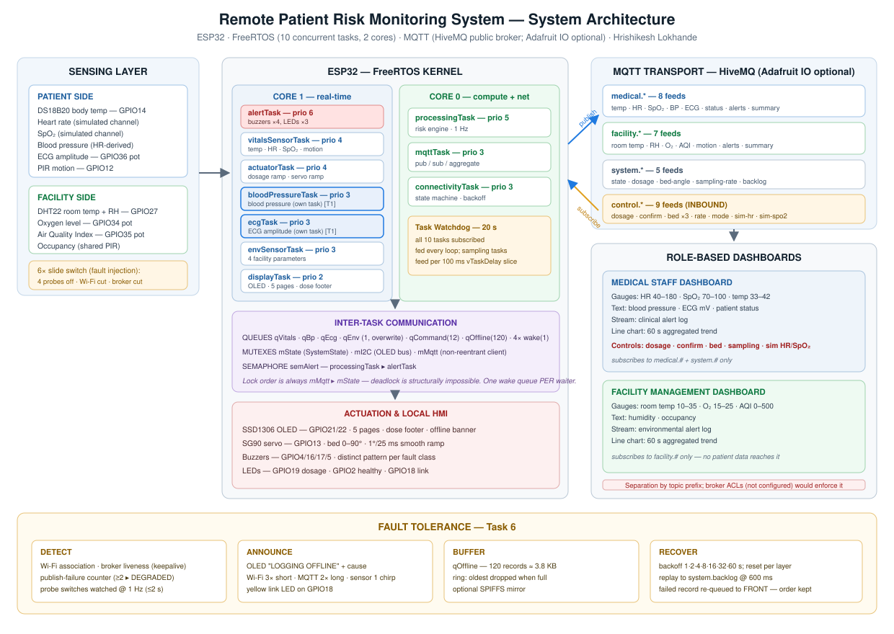
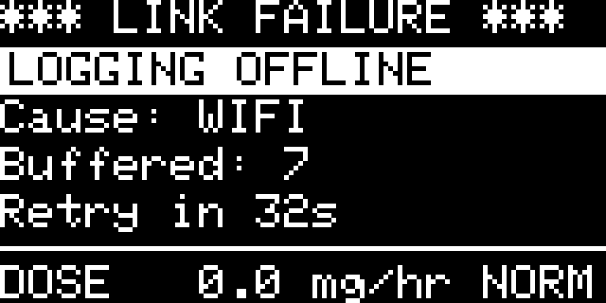
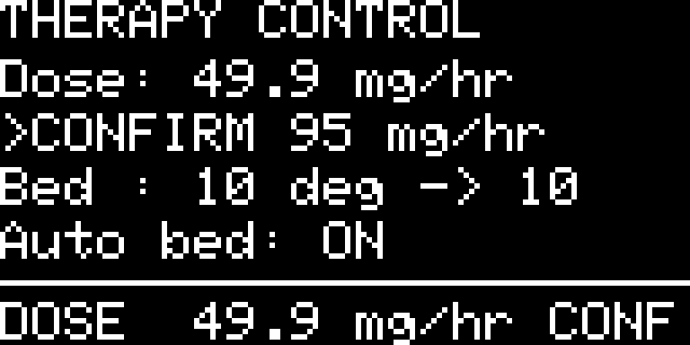
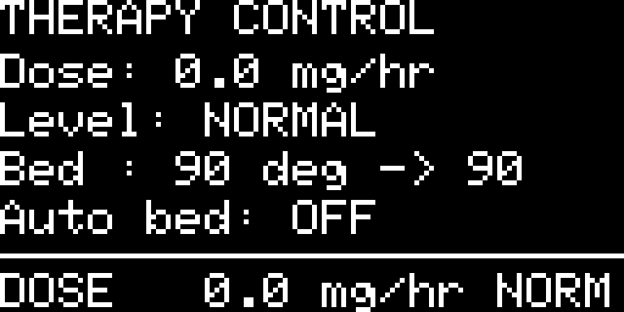

# Technical Report — Remote Patient Risk Monitoring System

**Intern:** Hrishikesh Lokhande · **Programme:** ElevanceSkills Internship — IoT / Embedded Systems
**Project:** Learn to Build a Real World Remote Patient Risk Monitoring System
**Platform:** ESP32 (dual-core) · FreeRTOS · MQTT · Wokwi simulator · Node-RED dashboards
**Date:** October 2026 · **Firmware build:** `2026-10-13 final`

| Artefact | Location |
|----------|----------|
| Source code, circuit, docs | GitHub — https://github.com/Hrishikesh1009/RemotePatientRiskMonitoring |
| Live simulation (public, no login) | Wokwi — https://wokwi.com/projects/473060533558119425 |
| Demonstration video (4 min 57 s) | Google Drive — https://drive.google.com/file/d/1z_txnAd4YhKfVJfZGMZbQZoqUU3RGK9w/view?usp=sharing (script and timeline: `docs/DEMO_VIDEO_SCRIPT.md`) |

---

## How this report maps to the portal's required sections

The portal asks for a report that explains: *Project Overview, Architecture, RTL Design,
FSM Design, Verification Methodology, Simulation Results, Challenges Faced, Conclusions.*
The wording of that list comes from a hardware-description (RTL/ModelSim) track. **This
project is embedded firmware plus a circuit, not HDL** — there is no RTL and there are no
ModelSim waveforms. Each heading is kept, and mapped to what the project genuinely has:

| Portal section | Where | What it contains here |
|---|---|---|
| Project Overview | §1 | Problem, solution, the six tasks, what is simulated vs. real |
| Architecture | §2 | System, hardware, software (tasks, IPC, MQTT topics), dashboards |
| **RTL Design** | §3 *Hardware & Firmware Design* | The circuit (pin map, wiring) and the firmware design in place of RTL |
| **FSM Design** | §4 *State-Machine Design* | The connectivity, dosage-confirmation, sampling, bed and display state machines with transition tables |
| Verification Methodology | §5 | How the system was verified in simulation, and its limits |
| Simulation Results | §6 | Measured results for 16 test cases (49 automated checks); the "waveforms" are serial, MQTT, OLED, LED/servo traces |
| Challenges Faced | §7 | The hard problems and what fixed them (cross-referenced to `BUG_LOG.md`) |
| Conclusions | §8 | Outcome, limitations, future work |

---

## 1. Project Overview

### 1.1 Problem
A ward monitor that merely beeps at a threshold is not enough: the alarm must stay alive
when the network fails, a doctor's remote commands must never cause an abrupt physical
change, facilities staff must not be handed patient data, and data must not be lost
during an outage. The internship brief turns those pressures into six tasks.

### 1.2 Solution
One integrated ESP32 application — **not six sketches** — extending the training project
(`IoT-in-healthcare`). It samples six patient parameters and four room parameters,
scores clinical and facility risk, publishes to two role-separated dashboards, accepts
remote control of medication dosage and bed elevation, adapts its own sampling rate, and
keeps logging across network loss with an automatic, ordered resync.

| # | Task | One-line result | Key evidence |
|---|------|-----------------|--------------|
| 1 | Multi-Sensor Expansion Using FreeRTOS | 10 concurrent tasks; BP and ECG each in their own task; 10 queues, 3 mutexes, 1 semaphore, 20 s watchdog | TC-01, TC-02 |
| 2 | Dual-Role IoT Monitoring | `medical.*` / `facility.*` topic groups, threshold gauges, alert feeds, 60 s aggregation | TC-04, TC-05, TC-06 |
| 3 | Smart Medication Dosage | 0–100 mg/hr slider, 5 mg/hr/s rate limiter, >80 confirmation gate, red LED + buzzer, dose on every OLED screen | TC-07, TC-08, TC-14 |
| 4 | Intelligent Bed Elevation | Servo 0–90°, 1°/25 ms ramp, presets 10/45/90°, condition-driven auto mode, manual always wins | TC-09, TC-10 |
| 5 | Smart Dynamic Sampling | 5–60 s slider; auto 5 s ↔ 30 s with 3-sample hysteresis; `vTaskDelay` slices + wake queues | TC-11 |
| 6 | Advanced Offline Detection | ONLINE/DEGRADED/OFFLINE; "LOGGING OFFLINE"; per-fault buzzers; 120-record buffer; backoff; ordered resync; on-demand fault injection | TC-12, TC-13 |

### 1.3 What is real and what is simulated
Wokwi has no pulse-oximeter, blood-pressure cuff or gas sensor. Heart rate and SpO₂ are
software-generated (a mean-reverting random walk with rare episodes, and an operator
override); blood pressure is derived from heart rate; ECG amplitude, oxygen and AQI come
from potentiometers. Body temperature (DS18B20), room temperature/humidity (DHT22), motion
(PIR), the OLED, servo, LEDs and buzzers are real Wokwi parts. Real hardware would replace
only the simulation block inside `vitalsSensorTask`. Everything is disclosed in
`ASSUMPTIONS.md`; this is an educational demonstrator, not a medical device.

---

## 2. Architecture



### 2.1 Layers

```
 SENSING                   ESP32 / FreeRTOS (10 tasks, 2 cores)                 CLOUD / UI
 DS18B20, DHT22, PIR  ┐    core 1: alert · vitals · BP · ECG · env ·            MQTT broker
 pots (ECG/O2/AQI)    ├──▶   actuator · display                          ──▶   (HiveMQ)  ──▶ Node-RED
 6 slide switches     ┘    core 0: processing · mqtt · connectivity                         ├ Medical dashboard
                           queues · mutexes · semaphore · watchdog         ◀── control.*    └ Facility dashboard
 ACTUATION: SSD1306 OLED · SG90 servo · 3 LEDs · 4 buzzers
```

### 2.2 Task architecture (Task 1)

| Task | Prio | Core | Stack | Period | Responsibility |
|------|------|------|-------|--------|----------------|
| `alertTask` | 6 | 1 | 4096 | event + 500 ms | All buzzers and LEDs |
| `processingTask` | 5 | 0 | 8192 | 1 s | Risk engine, adaptive sampling, auto bed, probe watcher, offline buffering |
| `vitalsSensorTask` | 4 | 1 | 4096 | 5–60 s | Temperature, heart rate, SpO₂, motion |
| `actuatorTask` | 4 | 1 | 3072 | 25 ms | Dosage ramp and servo ramp |
| `bloodPressureTask` | 3 | 1 | 3072 | 5–60 s | Blood pressure (derived from HR) |
| `ecgTask` | 3 | 1 | 3072 | 5–60 s | ECG amplitude |
| `envSensorTask` | 3 | 1 | 4096 | 10–120 s | Room temperature, humidity, O₂, AQI |
| `mqttTask` | 3 | 0 | 8192 | 200 ms loop | Publish per sample, subscribe, aggregate, idle keepalive |
| `connectivityTask` | 3 | 0 | 4096 | 1 s | Link state machine, backoff, replay |
| `displayTask` | 2 | 1 | 4096 | 1 s redraw | OLED pages and footer |

**Core split.** Anything that can block on the network (`mqttTask`, `connectivityTask`)
is on core 0. Everything with a timing obligation to the physical world is on core 1, so a
stalled TCP write cannot delay an alarm — the original single-task design's defect (B-03).

**Inter-task communication.** Queues: `qVitals`, `qBp`, `qEcg`, `qEnv` (depth 1,
overwrite — consumers always see *now*), `qCommand` (12, FIFO — no command is dropped),
`qOffline` (120, store-and-forward), and four wake queues (one per sampling task — a
shared one would starve all but one waiter, B-07). Mutexes: `mState` (the whole
`SystemState`), `mI2C`, `mMqtt`. Binary semaphore `semAlert`. Only one lock nesting exists
(`mMqtt` → `mState`), so deadlock cannot form. Detail in `ARCHITECTURE.md`.

### 2.3 MQTT topics (Task 2)

```
<prefix>/feeds/medical.{body-temperature,heart-rate,spo2,blood-pressure,ecg,patient-status,alerts,summary}   (8)
<prefix>/feeds/facility.{room-temperature,humidity,oxygen-level,aqi,motion,alerts,summary}                   (7)
<prefix>/feeds/system.{state,dosage,bed-angle,sampling-rate,backlog}                                         (5)
<prefix>/feeds/control.{dosage,dosage-confirm,bed-angle,bed-preset,bed-auto,sampling-rate,sampling-mode,sim-hr,sim-spo2}  (9, inbound)
```
`<prefix>` = `rprms-hl-8842` on the public `broker.hivemq.com`. **Role separation is by topic
prefix. It is not enforced access control** — the default broker has no ACLs, so any client
could subscribe to either prefix. Real enforcement needs per-credential ACLs on the
deployed broker; that is infrastructure outside this project (stated in `TASK_MAPPING.md`).

### 2.4 Dashboards
Two Node-RED tabs (`dashboards/node-red-flows.json`, 84 nodes): **Medical Staff**
(gauges for heart rate, SpO₂, temperature; BP/ECG; alert log; trend; the control sliders;
the patient-simulation sliders) and **Facility Management** (gauges for room temperature,
oxygen, AQI; humidity, occupancy, alert log, trend, system health). The facility tab
contains no `medical.*` widget.

---

## 3. Hardware & Firmware Design  *(the portal's "RTL Design" slot)*

### 3.1 Circuit (`diagram.json`, 26 parts, 64 connections)

| GPIO | Part | Purpose | Task |
|------|------|---------|------|
| 14 | DS18B20 | Patient body temperature | inherited |
| 27 | DHT22 | Room temperature + humidity | T1, T2 |
| 12 | PIR | Patient movement | inherited |
| 36 (VP) | Potentiometer | ECG amplitude 0–5 mV | T1 |
| 34 / 35 | Potentiometers | Room O₂ 15–25 % / AQI 0–500 | T2 |
| 4 / 16 / 17 / 5 | Buzzers 1–4 | temp / HR / SpO₂+dose / motion+connectivity | inherited, T3, T6 |
| 32 / 33 / 25 / 26 | Slide switches | Simulate temp / HR / SpO₂ / PIR probe disconnect | T1, T6 |
| **23 / 39 (VN)** | **Slide switches** | **Fault injection: Wi-Fi cut / broker unreachable** | **T6** |
| 21 / 22 | I²C | SSD1306 OLED | inherited |
| 13 | SG90 servo | Bed elevation 0–90° | T4 |
| 19 / 2 / 18 | LEDs | Dosage (red) / healthy (green) / link (amber) | T3, T6 |

Wiring decisions that were found by measurement, not assumed (all in `BUG_LOG.md`): the
DevKit-V1 pins for GPIO16/17 are named `RX2`/`TX2` (B-15); the board has only `GND.1`
and `GND.2` (B-16); the dosage LED is on GPIO19 (B-14); the servo pulse range is calibrated
to Wokwi's SG90 so the horn shows the commanded angle (B-31).

### 3.2 Firmware organisation (`main.ino`, single file)
Seventeen banner-commented sections: configuration, pin map, thresholds, topics, shared
types, globals, helpers, the ten task bodies, offline buffer, connectivity, MQTT, command
application, setup. Every block is tagged with the task(s) it implements (`[T1][T5]`). All
structures used in function signatures are declared before the first function — required
by the Arduino auto-prototype generator (B-04).

### 3.3 Design of each task

**Task 1 — concurrency.** Ten tasks, priorities 6/5/4/3/2. BP and ECG each have their own
task and queue because the brief says each added parameter is "managed by separate
FreeRTOS tasks"; `bloodPressureTask` peeks `qVitals` for heart rate, a genuine
task-to-task dependency over a queue. The watchdog (20 s, panic) covers all ten tasks; the
sampling delay feeds it every 100 ms slice.

**Task 2 — dual-role.** Data is published to disjoint topic prefixes; alert feeds carry a
line only when risk ≠ NORMAL; every 60 s `mqttTask` publishes a JSON aggregate (`n`, mean,
min, max) per role. Gauge thresholds: heart rate 60/120 bpm, SpO₂ 85/90 %, body temp
37.5/38.0 °C, room 18–26 °C, O₂ 19.5–23.5 %, AQI 150/300.

**Task 3 — dosage.** Three variables sit between slider and infusion:
`dosageSetpoint → dosageTarget → dosageCurrent`. A request above 80 mg/hr pins the target
at 80 and raises a confirmation request that expires after 15 s *downward* to 80, so
inaction can never overdose. `actuatorTask` moves the delivered dose at ≤ 5 mg/hr/s. The OLED
footer `DOSE 60.0 mg/hr WARN` is on every screen, redrawn at 1 Hz. Above 80 (or while a
request is pending) the red LED blinks 5 × 60 ms and buzzer 3 sounds.

**Task 4 — bed.** `applyCommand()` only sets a *target*; `actuatorTask` is the only code
that moves the servo and it always ramps (1°/25 ms; emergency 3°/step). So slider, preset
and auto mode cannot bypass the ramp. Auto mode: SpO₂ < 85 with CRITICAL → 90°, SpO₂ < 90 →
45°, NORMAL → 10°. Any manual command turns auto off.

**Task 5 — sampling.** Manual slider 5–60 s; auto mode drops to 5 s when either risk is not
NORMAL and returns to 30 s after 3 *fresh* normal samples. The wait is built from 100 ms
`vTaskDelay()` slices that poll the task's own wake queue without blocking; the loop
subtracts its own work time so "5 s" is 5.0 s. `mqttTask` publishes once per new sample.

**Task 6 — fault tolerance.** `connectivityTask` evaluates the link every second and owns
recovery. Offline, `processingTask` buffers one record per sampling period in `qOffline`;
the OLED shows the banner with cause, buffered count and a live retry countdown; buzzer 4
sounds a pattern per fault class. On restore the backlog replays in order to
`system.backlog`. Two slide switches (`swWifiCut`, `swBrokerCut`) break the *real* link on
demand so this can be demonstrated and tested repeatably.

### 3.4 Clinical and facility thresholds (illustrative, not validated)
Body temp warn 37.5 / critical 38.0 °C · heart rate warn < 60 or > 120, critical ≤ 50 or
≥ 150 bpm · SpO₂ warn < 90, critical < 85 % · systolic BP warn > 140 or < 90 mmHg · room
18–26 °C · O₂ 19.5–23.5 % · AQI warn 150, critical 300 · dosage warn ≥ 60, critical > 80 mg/hr.

---

## 4. State-Machine Design  *(the portal's "FSM Design" slot)*

### 4.1 Connectivity — Task 6 (`connectivityTask`, 1 Hz)

```
          Wi-Fi lost                              ≥2 publish failures
 ┌──────────────────────┐                         or a probe disconnected
 │                      ▼                                │
 │   ┌──────────┐  broker lost  ┌──────────┐   link up   ▼   ┌───────────┐
 │   │  ONLINE  │──────────────▶│ OFFLINE  │◀────────────────│ DEGRADED  │
 │   └──────────┘               └──────────┘  Wi-Fi/broker   └───────────┘
 │        ▲  ▲                      │  ▲  lost                    │
 │        │  └──────────────────────┘  └─────────────────────────┘
 │        │   restore ▸ replay backlog          faults clear
 └────────┴───────────────────────────────────────────────────────┘
```

State is recomputed every second, strictly in this priority order:

| # | Condition | State | Cause (`FaultKind`) |
|---|-----------|-------|---------------------|
| 1 | `WiFi.status() != WL_CONNECTED` | OFFLINE | `WIFI` |
| 2 | Wi-Fi up, `!mqtt.connected()` | OFFLINE | `MQTT` |
| 3 | link up, ≥ 2 consecutive publish failures | DEGRADED | `MQTT` |
| 4 | link up, a patient probe is disconnected | DEGRADED | `SENSOR` |
| 5 | none of the above | ONLINE | — |

| Transition | Guard | Actions |
|------------|-------|---------|
| any → OFFLINE | rule 1 or 2 | OLED banner `*** LINK FAILURE *** / LOGGING OFFLINE / Cause / Buffered / Retry in`; amber LED; buzzer pattern (Wi-Fi 3 × 80 ms, broker 2 × 400 ms); start buffering; tear down any MQTT session |
| OFFLINE (retry) | `now ≥ nextAttempt` | Wi-Fi: `WiFi.begin()`; broker: `mqtt.connect()`; on failure backoff ×2 (1,2,4,8,16,32,60 s); on **success of a layer** backoff ← 1 s and the next layer is tried next tick |
| OFFLINE → ONLINE/DEGRADED | rules 3–5 | replay `qOffline` in order to `system.backlog` (600 ms apart; failed record re-queued at the **front**); reset backoff |
| ONLINE → DEGRADED | rule 3 or 4 | amber LED; single chirp for a probe fault; keep publishing |
| DEGRADED → ONLINE | faults clear | LED off |

Every change is written to the serial log (`[NET] state A -> B (fault: X)`). The fault
switches only hold a recovery attempt "failed" while thrown; they change the real link
(`WiFi.disconnect()`, `mqtt.disconnect()`), so the transitions above are the production
ones.

### 4.2 Dosage confirmation — Task 3

```
        request ≤ 80                      request > 80
 ┌────────────────────────┐        ┌───────────────────────────────┐
 │       TRACKING         │───────▶│          PENDING              │
 │ target = request       │        │ target = 80, 15 s timer       │
 └───────────▲────────────┘        │ alarm: red LED + buzzer 3     │
             │ any new request     └──────┬────────────────┬───────┘
             │                    confirm=1│                │ 15 s, no confirm
             │                            ▼                ▼
             │                   ┌────────────────┐  ┌───────────────┐
             └───────────────────│   RELEASING    │  │  HOLD at 80   │
                                 │ target = request│  │ (safe ceiling)│
                                 └────────────────┘  └───────────────┘
```
In every state `dosageCurrent` chases `dosageTarget` at ≤ 5 mg/hr per second, so no state
can produce a step. The OLED footer level: `NORM` < 60, `WARN` 60–80, `CRIT` > 80, `CONF`
while PENDING.

### 4.3 Adaptive sampling — Task 5

| Mode | Rate | Leaves when |
|------|------|-------------|
| MANUAL | the slider value (5–60 s) | `control.sampling-mode = 1` → AUTO |
| AUTO / WATCH | 5 s | 3 consecutive *fresh* normal samples → AUTO / STABLE |
| AUTO / STABLE | 30 s | patient or facility risk ≠ NORMAL → AUTO / WATCH |
| AUTO (initial) | 15 s | as above |

Any manual rate command → MANUAL. "Fresh" means a new vitals sample number, not a loop
tick (B-17). A rate change wakes all four sampling tasks immediately through their wake queues.

### 4.4 Bed control — Task 4

| Mode | Behaviour | Leaves when |
|------|-----------|-------------|
| AUTO (default) | SpO₂ < 85 & CRITICAL → 90°; SpO₂ < 90 → 45°; NORMAL → 10°; otherwise unchanged | any manual angle/preset → MANUAL |
| MANUAL | holds the commanded target | `control.bed-auto = 1` → AUTO |

### 4.5 Display
Pages `PATIENT → EXTENDED → FACILITY → THERAPY → SYSTEM` rotate every 3 s while not OFFLINE;
OFFLINE pre-empts them with the banner; the dose footer is drawn on every screen. The whole
screen is redrawn at 1 Hz.

---

## 5. Verification Methodology

### 5.1 Principle
A design is not verified because it compiles. Each claim in `TASK_MAPPING.md` has a test
in `TEST_PLAN.md`, and each test was run on the real simulated firmware and measured, not
judged by eye.

### 5.2 Environment
* **Simulator:** the public Wokwi project (ESP32 DevKit-V1, all parts), built on Wokwi's
  cloud toolchain from the exact `main.ino`/`diagram.json`/`libraries.txt` in this repo.
* **Measurement rig** (kept outside the deliverable): headless Chrome driven over the
  DevTools protocol to start the simulation, press the real on-screen switches, move the
  potentiometers, and read — as data — the **serial monitor**, the **OLED framebuffer**
  (a 128×64 canvas), the **state of every LED, buzzer and the servo horn**, and the
  simulation clock; plus an **independent MQTT client** subscribed to the live broker. Every
  duration below is in **simulated** time (the serial `t=… ms` stamps), so it does not depend
  on how fast the simulator runs on the host.
* **Compile:** `BUILD_VERIFICATION.md`.

### 5.3 What counts as a "waveform" here
There are no HDL waveforms. The equivalent traces are: serial timestamps (ramps, cadence,
state transitions), OLED frames, the LED/buzzer/servo state sampler, and the MQTT message
timeline captured by an independent subscriber.

### 5.4 Fault injection
`swWifiCut` / `swBrokerCut` (Task 6), the four probe switches (Tasks 1, 6), the AQI/O₂/ECG
potentiometers (Tasks 1, 2), `control.sim-hr` / `control.sim-spo2` (Tasks 4, 5), and the
DS18B20 temperature attribute (fever) make every state reachable on demand.

### 5.5 Limits
The simulator ran at roughly 35–90 % of real time on the test machine (the speed moves
with host load), so there were no multi-hour soak runs (the longest continuous run is
reported in §6). Two paths are
**not** exercised: DEGRADED caused by publish failures (no control can make publishes
fail while the link is up), and the optional SPIFFS mirror (`USE_SPIFFS 0`).

---

## 6. Simulation Results

All figures below are measured on the final build — `main.ino` SHA-256
`9e69da719afebbf68aa48637d9e12146e0f486461ead55e3a46ef7f892e43739`, built by Wokwi's cloud
toolchain (HTTP 200, image 1,600,201 bytes). Durations are **simulated** time. Raw logs, JSON
results and frames: `docs/evidence/`; every individual check, the run history and the limits:
`TEST_RESULTS.md`.

**49 of 49 automated checks pass**, plus 4 of 4 supplementary pixel-level checks. Free heap
166 KB after boot → 165 KB after the run; one boot banner, no watchdog, panic or abort.

### 6.1 Results by test case

| TC | Task | Result | Headline measurement |
|----|------|--------|----------------------|
| 01 Boot, tasks, watchdog, OLED | T1 | ✅ 8/8 | 10 tasks, 20 s watchdog, one boot banner; all five OLED pages within 13.0 s (3 s dwell) |
| 02 Alarm cadence during an outage | T1 | ✅ | alarm pass period 1.01 s before vs 1.16 s during a Wi-Fi outage (ratio 1.15, limit 0.7–1.3) |
| 03 Probe disconnect → DEGRADED | T1, T6 | ✅ 4/4 | 3.4 s (temperature), 1.6 s (heart rate), 3.0 s (SpO₂) at the 30 s stable rate; never "Patient stable" |
| 04 Role separation | T2 | ✅ | 8 `medical.*` and 7 `facility.*` topics, disjoint (topic level only) |
| 05 Facility inputs | T1, T2 | ✅ 4/4 | AQI 317 → CRITICAL, 195 → WARNING; O₂ 15.59 % → CRITICAL; ECG 5.00 mV |
| 06 Aggregation | T2 | ✅ | 60 s JSON on both summary feeds, n = 9, internally consistent |
| 07 Dosage rate limit | T3 | ✅ | **5.00 mg/hr per second** |
| 08 Critical confirmation | T3 | ✅ 3/3 | unconfirmed 95 held at 80; gate expires after **15 006 ms**; red LED + buzzer while pending; confirm releases 95 by ramp |
| 09 Bed ramp, presets | T4 | ✅ 4/4 | 0 → 90° in **2.23 s** (1°/25 ms); emergency preset 0.73 s; manual turns Auto OFF |
| 10 Automatic bed | T4 | ✅ 4/4 | SpO₂ 88 → 46°, 82 → 89°, normal → 10°; manual 70° is never overridden |
| 11 Adaptive sampling | T5 | ✅ 6/6 | 5.08 s spacing at 5 s; 8/8 published once; wake in 1.26 s; 3-sample hysteresis |
| 12 Wi-Fi outage → resync | T6 | ✅ 6/6 | OFFLINE in 1.9 s; backoff 1·2·4·8·16 s; **8 buffered → 8 replayed in order**; ONLINE 13.1 s after release |
| 13 Broker outage | T6 | ✅ 3/3 | OFFLINE/MQTT in 0.7 s; 4 records replayed |
| 14 Dose on the OLED | T3 | ✅ | footer band identical on all five pages, follows the dose, present on the offline banner |
| 15 Command reliability | T3–5 | ✅ | 12 of 12 commands applied |
| 16 Stability | — | ✅ | no reset; heap 166 → 165 KB |

### 6.2 The traces ("waveforms")

The offline cycle of TC-12 as the serial monitor recorded it (Wi-Fi cut, five-second sampling,
real link, 8 samples buffered and replayed in order):

```
[FAULT] SW_WIFI_CUT ON -- Wi-Fi link CUT
[NET] state ONLINE -> OFFLINE (fault: WIFI)
[NET] recovery attempt, backoff=1s
[NET]   attempt failed: Wi-Fi link is down (SW_WIFI_CUT held)
[ALERT] buzzer 4, WIFI fault: 3 short beeps
[NET] recovery attempt, backoff=2s
[SAMPLE] vitals #75 at t=359209 ms: hr=90 spo2=97 (period 5 s)
[NET] recovery attempt, backoff=4s
[SAMPLE] vitals #76 at t=364293 ms: hr=91 spo2=96 (period 5 s)
[NET] recovery attempt, backoff=8s
   … samples #77–#80 buffered …
[NET] recovery attempt, backoff=16s
[FAULT] SW_WIFI_CUT OFF -- Wi-Fi link restored
[NET]   Wi-Fi re-associated -- reconnecting to the broker next
[NET] still OFFLINE, fault changed WIFI -> MQTT
[NET] state OFFLINE -> ONLINE (fault: none)
[NET] restored -- replaying 8 buffered samples
[NET] resynced 8 records
```

OLED frames from the same run (the 128×64 framebuffer read as pixels, shown 6×):

| | |
|---|---|
|  | `*** LINK FAILURE *** / LOGGING OFFLINE / Cause: WIFI / Buffered: 7 / Retry in 32s`, dose footer still present |
|  | `>CONFIRM 95 mg/hr`: the delivered dose is held below 80 while the request waits; footer `CONF` |
|  | `Auto bed: OFF` after a manual angle command |

### 6.3 Honest scope

Two paths are **not** exercised — DEGRADED caused by publish failures, and the failing-write branch
of the watchdog fix (B-38) — because the simulator cannot make the link stall on demand. The run
history (43 → 46 → 49 of 49, with the cause of every failure) is in `TEST_RESULTS.md` §4.

---

## 7. Challenges Faced

The defects that mattered most, with the evidence that exposed them (full list and
measurements in `BUG_LOG.md`).

1. **The simulator's pins are not the datasheet's.** Buzzers wired to `D16`/`D17` attached to
   nothing; pots and probe switches grounded to a `GND.3` that does not exist; the red LED on
   GPIO15 never lit. Found by reading the board's own pin list and driving every output
   (B-14 – B-16). Until fixed, several earlier "tests" could not have exercised those outputs.
2. **A restart is not an outage.** The offline requirement is about *keeping data across* a
   failure, but the only way to fail Wi-Fi in Wokwi was to restart, which wipes RAM. Two
   fault-injection switches that act on the real link made the whole cycle repeatable (B-27).
3. **"Continuously monitors … health" was once per sampling period.** A probe disconnect
   took 32 s to notice at the stable 30 s rate; a 1 Hz watcher cut it to 2–3 s (B-28).
4. **Backoff that punishes recovery.** The broker attempt inherited a 60 s delay earned by
   Wi-Fi failures: 65 s to come back. Resetting the streak per layer: 10.6 s (B-29).
5. **Garbage in, alarms out.** The risk engine scored its own zero-filled seed data at boot
   and raised a phantom critical alarm and a bogus record (B-30).
6. **The cadence the dashboard saw was not the cadence configured.** A keepalive on every
   200 ms pass plus a free-running publish timer gave 2–3× the sampling period; idle-only
   keepalive and publish-per-sample fixed it (B-32).
7. **The simulated patient did not stay stable**, which made every demo non-deterministic
   (B-33). Mean reversion plus an operator override fixed it and made Tasks 4 and 5
   demonstrable on demand.
8. **Honesty about role-based access.** The first report claimed access control was enforced;
   an audit showed only topic separation exists (B-11). It is now stated plainly.
9. **A slow host.** The test machine ran the simulator at 3–16 % in a normal browser pane;
   moving the measurement to a headless browser reached 35–90 %, which is what made
   timing measurements possible at all.
10. **Wall-clock windows are not simulated-time windows.** Because that speed moves with host
    load, three checks failed in the first full runs for reasons that had nothing to do with
    the firmware: the OLED-rotation watch (TC-01h) and the alarm-cadence windows (TC-02) were
    wall-clock sleeps that covered only 1–10 simulated seconds, and one click on a probe
    switch was silently lost (TC-03). Every window is now measured on the simulator's own
    clock, and a switch click is verified and repeated until the part reaches the requested
    state. Reasoning from the traces, not re-running until green, is what separated "rig"
    from "firmware" here (details in `TEST_RESULTS.md`).
11. **A stalled network rebooted the chip.** Late in the work, during an unrelated screenshot
    session, the task watchdog reset the device: `mqttTask` had been blocked in a chain of
    un-fed TCP writes to a link that had stopped draining. It never showed up in the 49-check
    run because it needs a network stall, which Wokwi cannot produce on demand. The log line
    that mattered was the *absence* of `[MQTT] published` lines for 30 s while sampling
    carried on. The fix feeds the watchdog before every write, ends a publish round at the
    first failure and probes a suspect session every second (B-38); the whole suite was then
    re-run on the new build.

---

## 8. Conclusions

All six tasks are implemented in one integrated, running project and were verified in the
Wokwi simulator against measured criteria rather than by inspection. The most valuable work
was not adding features but making the safety properties *structural*: alarms on a core
that never blocks on the network; one lock order so deadlock cannot form; every actuator
command through one rate-limited path so no interaction can produce an abrupt change; a
confirmation gate that fails downward; and a recovery path that is tested by breaking the
real link, not by flipping a flag.

**Limits, stated plainly.** Role-based access is topic separation only. Heart rate, SpO₂
and BP are simulated; thresholds are illustrative, not clinically validated; this is not a
medical device. DEGRADED-by-publish-failure and SPIFFS persistence are implemented but not
exercised in simulation.

**Future work.** TLS (8883) and per-role broker ACLs; SNTP/RTC timestamps (buffered records
use `millis()`); a redundant alarm path (IEC 60601-1-8); real sensors (MAX30102, AD8232,
MQ-135) replacing only the simulation block; OTA updates.

---

## Appendix — repository map

```
main.ino  diagram.json  libraries.txt  wokwi.toml       firmware + circuit (what Wokwi runs)
README.md                                               entry point, quick start, demo guide
docs/TECHNICAL_REPORT.md                                this report
docs/TASK_MAPPING.md                                    clause-by-clause evidence for the six tasks
docs/ARCHITECTURE.md                                    design rationale
docs/TEST_PLAN.md   docs/TEST_RESULTS.md                16 test cases and the measured results
docs/BUG_LOG.md     docs/ASSUMPTIONS.md                 mandatory logs
docs/SELF_ATTESTATION.md                                mandatory checklist (to be completed by the intern)
docs/BUILD_VERIFICATION.md  docs/DASHBOARD_SETUP.md  docs/NODE_RED_SETUP.md
docs/DEMO_VIDEO_SCRIPT.md   docs/SUBMISSION_CHECKLIST.md
docs/architecture-diagram.svg  docs/workflow-diagram.svg
docs/evidence/                                          serial logs, MQTT capture, test-run JSON
dashboards/   screenshots/   tools/                     flows, 15 screenshots, helper scripts
```

## References
FreeRTOS kernel documentation (task priorities, queues, mutexes) · Espressif ESP-IDF
(task watchdog, ADC, dual-core) · Adafruit MQTT Library 2.x · Wokwi documentation (ESP32
DevKit-V1 pinout, SSD1306, SG90) · IEC 60601-1-8 (alarm-system principles; no compliance
claimed) · original training project `IoT-in-healthcare/main.ino`, ElevanceSkills.
